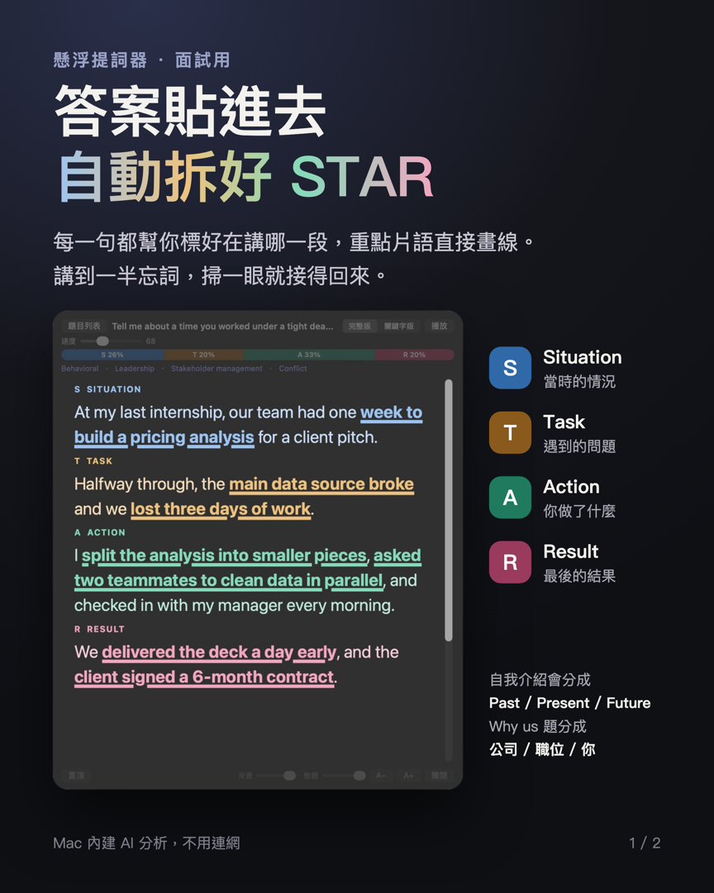
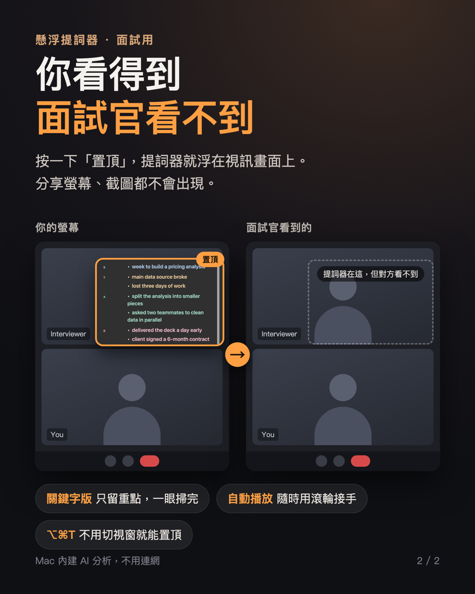

# FloatPrompter 懸浮提詞器

面試用的 Mac 懸浮提詞器。答案貼進去，會自動拆成 STAR 段落、標出重點；面試時按「置頂」，提詞器浮在視訊畫面上，分享螢幕時對方看不到。

A floating teleprompter for video interviews on macOS. Paste your answer and it is split into STAR sections with key phrases highlighted. Pin it on top of your call — it stays hidden from screen sharing.

<p>
  
  
</p>

## 功能

- **自動分段**：Behavioral 題分成 S / T / A / R；自我介紹分成 Past / Present / Future；Why us 分成公司 / 職位 / 你。每句標出 1–2 個關鍵片語，並列出這個故事適合回答的題目主題
- **完整版／關鍵字版**：完整版看全文，關鍵字版一句一行只留重點（K 鍵切換）
- **置頂**：浮在所有視窗上（包含全螢幕的 Zoom / Meet），分享螢幕和截圖都看不到；取消置頂就是一般視窗
- **自動播放**：空白鍵播放／暫停，↑↓ 調速度，也可以隨時用滾輪手動捲
- **可調整**：背景透明度、整體透明度、字體大小、速度
- **點兩下就能編輯**，存檔後自動重新分析
- 分析用 Mac 內建的 Apple Intelligence，在你的電腦上跑，不用連網，答案不會傳到任何地方

## 系統需求

- macOS 26（Tahoe）以上
- 自動分段需要開啟 Apple Intelligence（Apple 晶片的 Mac）。沒開也能當提詞器用，只是不會分段

## 安裝

1. 到 [Releases](../../releases) 下載最新的 `FloatPrompter.zip`
2. 解壓縮，把 `FloatPrompter.app` 拖進「應用程式」資料夾
3. 第一次打開會跳出「無法打開」的警告（因為這個 App 沒有付費跟 Apple 註冊開發者）。照下面其中一種方法打開：
   - **方法 A**：按「完成」關掉警告 → 打開「系統設定 › 隱私權與安全性」→ 往下捲，按「強制打開」→ 輸入密碼
   - **方法 B**：打開「終端機」，貼上這行按 Enter：
     ```bash
     xattr -dr com.apple.quarantine /Applications/FloatPrompter.app
     ```
4. 之後就能正常打開了

## 使用方式

1. 按「新增」，第一行貼題目，下面貼你的答案，按 ⌘S 儲存（會自動分析，約 5–15 秒）
2. 在列表點兩下題目進入提詞畫面
3. 面試開始前按「置頂」（或 ⌥⌘T）

| 快捷鍵 | 功能 |
|---|---|
| 空白鍵 | 播放／暫停 |
| ↑ ↓ | 調速度 |
| K | 切換完整版／關鍵字版 |
| R | 回到開頭 |
| Esc | 回題目列表 |
| ⌘+ ⌘− | 字體大小 |
| ⌥⌘P | 顯示／隱藏（任何 App 裡都能用） |
| ⌥⌘T | 置頂開關 |
| ⌥⌘O | 播放／暫停（任何 App 裡都能用） |
| ⌥⌘↑ ⌥⌘↓ | 調速度（任何 App 裡都能用） |
| ⌥⌘B | 回題目列表 |

> 「分享螢幕看不到」已在 Google Meet 實測。其他會議軟體請先用測試會議確認一次。

題目資料存在 `~/Library/Application Support/FloatPrompter/notes.json`。

## 自己編譯

需要 Xcode 或 Command Line Tools（`xcode-select --install`）。

```bash
git clone <這個 repo 的網址>
cd FloatPrompter
./build.sh            # 編譯並安裝到 ~/Applications
./build.sh release    # 產生 dist/FloatPrompter.zip（Apple 晶片 + Intel 通用版）
```

整個 App 只有一個檔案 `main.swift`（Swift + AppKit）。

## 授權

MIT
